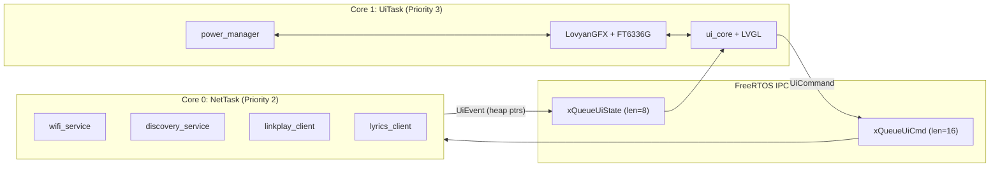

# Senior Engineering Evaluation Report — WiiM ESP32-S3 Remote

## Executive Summary

The **WiiM ESP32-S3 Touchscreen Remote** codebase (`v1.4.0`) has a strong architectural foundation:
- **Clean Dual-Core Separation**: Core 0 (`NetTask`) handles Wi-Fi, SSDP, LinkPlay HTTPS/UPnP, and LRCLIB requests, while Core 1 (`UiTask`) owns LovyanGFX SPI DMA rendering and LVGL state via FreeRTOS queues ([`main.cpp`](file:///c:/Users/guipe/OneDrive/Projects/wiimremote/src/main.cpp#L89-L110)).
- **Modular Decomposition**: Both `src/net/` and `src/ui/` are cleanly decomposed into single-responsibility compilation units with clear interfaces.
- **Thoughtful LinkPlay Quirks Handling**: Signed negative `curpos` DAC pre-buffer countdowns, transient buffering states (`PLAY_STATE_BUFFERING`), and UPnP SOAP duration fallbacks for Amazon Music are well engineered ([`linkplay_client.cpp`](file:///c:/Users/guipe/OneDrive/Projects/wiimremote/src/net/linkplay_client.cpp#L298-L338)).

Below is a consolidated audit of **verified bugs**, **performance bottlenecks**, **UI/UX improvements**, and **production-readiness gaps**, prioritized by severity and impact.



---

## 1. Verified Bugs & Logic Defects

### 🔴 [BUG-1] Saved Screen Brightness Overwritten on Every Boot (Initialization Order Bug)
- **Location**: [`setup()`](file:///c:/Users/guipe/OneDrive/Projects/wiimremote/src/main.cpp#L64-L87), [`power_manager_init()`](file:///c:/Users/guipe/OneDrive/Projects/wiimremote/src/power_manager.cpp#L41-L45), [`display_driver_init()`](file:///c:/Users/guipe/OneDrive/Projects/wiimremote/src/display_driver.cpp#L129-L135)
- **Symptom**: User-saved screen brightness in NVS is ignored on boot and wake from deep sleep; the backlight always resets to `BL_DEFAULT_BRIGHT` (`220` / ~86%).
- **Root Cause**:
  1. [`setup()`](file:///c:/Users/guipe/OneDrive/Projects/wiimremote/src/main.cpp#L65) calls `power_manager_init()` **before** `display_driver_init()` (line 87).
  2. `power_manager_init()` calls `display_set_backlight(...)` before `gfx.init()` has initialized the LEDC PWM channel.
  3. `display_driver_init()` then calls `gfx.init()` and immediately runs `display_set_backlight(BL_DEFAULT_BRIGHT)` (line 134), overwriting the NVS setting.
- **Recommendation**: Call `display_driver_init()` before `power_manager_init()` in `setup()` (or remove the hardcoded `BL_DEFAULT_BRIGHT` call in `display_driver_init()` and apply `power_manager_get_brightness_pct()` after `gfx.init()`).

---

### 🔴 [BUG-2] Memory Leak & Dropped UI Events on `xQueueUiState` Overflow
- **Location**: [`config.h`](file:///c:/Users/guipe/OneDrive/Projects/wiimremote/include/config.h#L104), [`wifi_service_start_scan()`](file:///c:/Users/guipe/OneDrive/Projects/wiimremote/src/net/wifi_service.cpp#L76-L105), [`on_wifi_connected()`](file:///c:/Users/guipe/OneDrive/Projects/wiimremote/src/network_manager.cpp#L26-L30), [`NetworkManager::runTaskLoop()`](file:///c:/Users/guipe/OneDrive/Projects/wiimremote/src/network_manager.cpp#L208-L234)
- **Symptom**:
  1. **Heap leak**: `wifi_service_start_scan()` allocates `WiFiScanList* pScan = (WiFiScanList*)malloc(sizeof(WiFiScanList))` and calls `xQueueSend(xQueueUiState, &evt, 0)` (line 104) **without checking the return value**. If `xQueueUiState` is full, `pScan` is leaked.
  2. **Stuck UI state / missing presets or metadata on connect**: `QUEUE_UI_STATE_LEN` is only `8`. When Wi-Fi connects, `wifi_service_handle()` + `on_wifi_connected()` + `discovery_service_trigger_rescan()` + `on_active_device_changed()` + `runTaskLoop()` can enqueue **9 to 12 events in a single loop pass** before removing the duplicate initial poll. Any event beyond slot 8 (such as `UI_EVT_SCAN_STATUS(false)` or `UI_EVT_PRESETS_UPDATED`) is silently dropped (`timeout = 0`), leaving the Device Modal stuck on `"Scanning for streamers..."`.
- **Recommendation**:
  - Free `pScan` if `xQueueSend(xQueueUiState, &evt, 0) != pdTRUE` in [`wifi_service.cpp`](file:///c:/Users/guipe/OneDrive/Projects/wiimremote/src/net/wifi_service.cpp#L104).
  - Increase `QUEUE_UI_STATE_LEN` from `8` to `24` (`sizeof(UiEvent)` is only 44 bytes, so 24 slots = ~1 KB of RAM).

---

### 🔴 [BUG-3] Wake-from-Dim Touch Gesture Clicks Underlying UI Controls
- **Location**: [`touchpad_read_cb()`](file:///c:/Users/guipe/OneDrive/Projects/wiimremote/src/display_driver.cpp#L95-L127), [`power_manager_notify_activity()`](file:///c:/Users/guipe/OneDrive/Projects/wiimremote/src/power_manager.cpp#L47-L53)
- **Symptom**: When the screen auto-dims to 10% brightness after inactivity, tapping the screen to wake it up simultaneously passes `LV_INDEV_STATE_PR` to LVGL—accidentally clicking Play/Pause, Mute, Next/Prev, or seeking the track to wherever the user touched.
- **Root Cause**: `touchpad_read_cb()` calls `power_manager_notify_activity()` and immediately forwards the touch press to LVGL on the same frame.
- **Recommendation**: Have `power_manager_notify_activity()` return `bool` (`true` if the display was dimmed and just woke up). When it returns `true`, latch a `s_swallow_touch_until_release` flag in `touchpad_read_cb()` that reports `LV_INDEV_STATE_REL` to LVGL until the user lifts their finger.

---

### 🔴 [BUG-4] Deep Sleep Power Drain, Unmuted Audio Amp, and Instant False-Wake Race
- **Location**: [`power_manager_enter_deep_sleep()`](file:///c:/Users/guipe/OneDrive/Projects/wiimremote/src/power_manager.cpp#L132-L139), [`hardware_pins_init()`](file:///c:/Users/guipe/OneDrive/Projects/wiimremote/src/main.cpp#L39-L43)
- **Symptom**:
  1. **ILI9341V stays awake in deep sleep**: `display_set_backlight(0)` turns off the backlight LED, but never sends the `SLPIN` (`0x10`) command (`gfx.sleep()`) to the ILI9341V controller. The TFT logic and charge pumps continue drawing ~5–10 mA throughout deep sleep.
  2. **`PIN_PA_EN` (GPIO 1) loses HIGH state in deep sleep**: `hardware_pins_init()` drives `PIN_PA_EN` HIGH to keep the onboard speaker amplifier muted. Entering deep sleep without `gpio_hold_en((gpio_num_t)PIN_PA_EN)` and `gpio_deep_sleep_hold_en()` allows GPIO 1 to float, potentially unmuting the audio amp and causing pops/quiescent battery drain.
  3. **Manual "Sleep" button race**: When tapping the `"Sleep"` button in [`modal_power.cpp`](file:///c:/Users/guipe/OneDrive/Projects/wiimremote/src/ui/modal_power.cpp#L52-L54), if the user's finger has not fully cleared the capacitive panel within 100ms, `TOUCH_INT` (GPIO 17, active LOW) is still asserted when `esp_deep_sleep_start()` runs, causing the ESP32-S3 to wake up immediately.
- **Recommendation**:
  - Call `gfx.sleep()` and `gfx.waitDisplay()` before sleeping.
  - Hold `PIN_PA_EN` HIGH across deep sleep via `gpio_hold_en((gpio_num_t)PIN_PA_EN); gpio_deep_sleep_hold_en();` (and release with `gpio_hold_dis` on boot).
  - Wait until `digitalRead(TOUCH_INT) == HIGH` (up to e.g. 1500ms) and enable `rtc_gpio_pullup_en((gpio_num_t)TOUCH_INT)` before calling `esp_deep_sleep_start()`.

---

### 🟠 [BUG-5] Corrupt Hex Decoding on Valid ASCII Names (`"ABBA"`, `"ACDC"`, `"CAFE"`, `"1984"`)
- **Location**: [`net_decode_hex_string()`](file:///c:/Users/guipe/OneDrive/Projects/wiimremote/src/net/net_utils.cpp#L39-L64)
- **Symptom**: Any plain-text artist, title, album, or preset name that happens to have an even number of characters consisting solely of `[0-9a-fA-F]`—such as **`"ABBA"`**, **`"ACDC"`**, **`"CAFE"`**, **`"FACE"`**, **`"DEAD"`**, **`"FADE"`**, **`"1984"`**, or **`"2024"`**—is misidentified as hex-encoded and decoded into garbled bytes (e.g. `"ABBA"` $\rightarrow$ `0xAB, 0xBA` $\rightarrow$ `"«º"`).
- **Root Cause**:
  - `getPresetInfo` and `getMetaInfo` return plain UTF-8 strings in JSON, whereas `getPlayerStatus` returns hex-encoded strings. Running `net_decode_hex_string()` on plain strings with a naive `[0-9a-fA-F]` check corrupts valid words made of hex letters.
  - Even for hex strings, `net_decode_hex_string()` falls back to `net_to_valid_utf8()`, which converts invalid UTF-8 bytes (`0xAB, 0xBA`) into Latin-1 characters instead of recognizing that `"ABBA"` was already plain ASCII.
- **Recommendation**:
  - Do not hex-decode fields that are only ever plain text if verified, **or** harden `net_decode_hex_string()`: if the input is valid printable ASCII and the candidate hex-decoded bytes contain control characters (`< 0x20` other than `\t\n\r`) or fail strict UTF-8 validation, return the original string untouched.

---

### 🟠 [BUG-6] Short Tracks (< 10 Seconds) Multiplied by 1000× into Multi-Hour Durations
- **Location**: [`linkplay_client_poll_active()`](file:///c:/Users/guipe/OneDrive/Projects/wiimremote/src/net/linkplay_client.cpp#L315-L318)
- **Symptom**: Any track, intro, or interlude shorter than 10 seconds (`totlen` between `1` and `9999` ms, e.g. `8000` ms = 8 seconds) has its duration multiplied by `1000` to `8,000,000` ms (**133 minutes**).
- **Root Cause**:
  ```cpp
  // If totlen is given in seconds (< 10000 for normal song durations), convert to ms
  if (totlen > 0 && totlen < 10000) {
      totlen *= 1000;
  }
  ```
  LinkPlay's `getPlayerStatus` returns `totlen` in **milliseconds** (`0` when unknown, or e.g. `6000` for a 6-second intro).
- **Recommendation**: Remove the `< 10000` heuristic (or only apply a seconds-to-ms conversion if `totlen > 0 && totlen < 1000 && curpos > totlen`).

---

### 🟠 [BUG-7] Duplicate Seek Commands Sent on Mid-Song "Previous" Tap
- **Location**: [`NetworkManager::processIncomingCommands()`](file:///c:/Users/guipe/OneDrive/Projects/wiimremote/src/network_manager.cpp#L104-L108)
- **Symptom**: Tapping **Previous** when `curpos > 5000` ms sends **both** a UPnP SOAP `Seek` (`linkplay_client_seek(activeDev.ip, 0)`) **and** an HTTPS GET `setPlayerCmd:seek:0` (`linkplay_client_send_cmd(...)`).
- **Impact**: Blocks Core 0 for two sequential network round-trips and causes a double-seek stutter on the streamer.
- **Recommendation**: Use a single seek mechanism consistently (either `linkplay_client_seek(activeDev.ip, 0)` or `setPlayerCmd:seek:0`).

---

### 🟠 [BUG-8] Redundant Network Polling Burst on Wi-Fi Connect & Device Switch
- **Location**: [`on_active_device_changed()`](file:///c:/Users/guipe/OneDrive/Projects/wiimremote/src/network_manager.cpp#L10-L24), [`on_wifi_connected()`](file:///c:/Users/guipe/OneDrive/Projects/wiimremote/src/network_manager.cpp#L26-L30), [`NetworkManager::runTaskLoop()`](file:///c:/Users/guipe/OneDrive/Projects/wiimremote/src/network_manager.cpp#L216-L243)
- **Symptom**: On initial connect or device switch, `on_active_device_changed()` fetches config, player status, and presets, and then `runTaskLoop()` immediately executes the `!_initialPresetsFetched`, `_lastStatusPoll`, and `_lastConfigPoll` blocks in the exact same turn—issuing **6 to 8 back-to-back HTTPS requests** for the same data.
- **Recommendation**: Update `_lastStatusPoll = millis()`, `_lastConfigPoll = millis()`, and `_initialPresetsFetched = true` whenever `on_active_device_changed()` runs.

---

### 🟡 [BUG-9] `is_fixed_volume` Clobbered on Rescan & Stale Playlist Counter (`X/Y`)
- **Location**:
  1. [`query_device_status()`](file:///c:/Users/guipe/OneDrive/Projects/wiimremote/src/net/discovery_service.cpp#L179) & [`add_or_update_device()`](file:///c:/Users/guipe/OneDrive/Projects/wiimremote/src/net/discovery_service.cpp#L219-L225): `query_device_status()` initializes `outDevice->is_fixed_volume = false`. If a device's IP or name updates in `add_or_update_device()`, `s_active_device = dev` overwrites the saved `is_fixed_volume` flag with `false` and doesn't call `save_active_device()`.
  2. [`ui_player_set_stream_info()`](file:///c:/Users/guipe/OneDrive/Projects/wiimremote/src/ui/ui_player.cpp#L682-L685): Only updates `current_track_num` and `current_track_total` when `track_total > 0`. When switching from a multi-track playlist (`5/12`) to a stream with `plicount == 0` (e.g. radio or single track), `"5/12"` remains stuck on screen.

---

## 2. Performance Optimizations

### ⚡ [PERF-1] Cut Idle/Playing UI Redraw Overhead by ~90% (`ui_player_tick_progress`)
- **Location**: [`ui_core.cpp`](file:///c:/Users/guipe/OneDrive/Projects/wiimremote/src/ui/ui_core.cpp#L25-L31), [`ui_player_tick_progress()`](file:///c:/Users/guipe/OneDrive/Projects/wiimremote/src/ui/ui_player.cpp#L689-L708)
- **Analysis**:
  - `timer_progress_cb` runs every **50ms (20 Hz)**.
  - Every 50ms, it calls `format_time()` and `lv_label_set_text(lbl_time_cur, ...)` even though `mm:ss` only changes once every **1000ms (1 Hz)**.
  - Every 50ms, it calls `lv_bar_set_value(bar_progress, val, LV_ANIM_OFF)` with `PROGRESS_BAR_MAX = 10000`. Because `bar_progress` is only **220 pixels wide**, 95% of those `val` increments do not change a single pixel on screen, yet LVGL invalidates and DMA-flushes the progress bar bounding box 20 times per second.
- **Optimization**:
  - Only call `format_time()` + `lv_label_set_text(lbl_time_cur, ...)` when `current_actual_curpos_ms / 1000` changes from the previously rendered second.
  - Set `PROGRESS_BAR_MAX` to `220` (1 unit = 1 physical pixel on the 220px bar) or only call `lv_bar_set_value()` when the mapped pixel value changes.

---

### ⚡ [PERF-2] Make Core 0 Network Scans & Probing Non-Blocking for Transport Controls
- **Location**: [`wifi_service_start_scan()`](file:///c:/Users/guipe/OneDrive/Projects/wiimremote/src/net/wifi_service.cpp#L63), [`discovery_service_trigger_rescan()`](file:///c:/Users/guipe/OneDrive/Projects/wiimremote/src/net/discovery_service.cpp#L359-L365), [`lyrics_client_fetch()`](file:///c:/Users/guipe/OneDrive/Projects/wiimremote/src/net/lyrics_client.cpp#L23)
- **Analysis**:
  - Because `NetTask` processes `xQueueUiCmd` at the top of `runTaskLoop()`, any long synchronous operation on Core 0 blocks Play/Pause, Volume, and Mute commands for its entire duration:
    - **Wi-Fi Scan**: `WiFi.scanNetworks(false, ...)` blocks Core 0 for **2.5–4.5 seconds**.
    - **Lyrics Fetch**: Up to two sequential HTTPS requests to `lrclib.net` with a 4000ms timeout can block Core 0 for **up to 8 seconds**.
    - **Device Rescan**: Probing offline NVS IPs sequentially (`800ms` HTTP + `1500ms` HTTPS = `2.3s` per unreachable IP) blocks Core 0 for **2.3s × N offline devices**.
- **Optimization**:
  - Switch `WiFi.scanNetworks(true, false, false, 150)` to **async mode** and poll `WiFi.scanComplete()` inside `wifi_service_handle()`.
  - Add a lightweight LAN connect timeout (`http.setConnectTimeout(350)`) in `query_device_status()` so unreachable LAN IPs fail in 350ms instead of 2300ms, and pump `processIncomingCommands()` between probes.
  - Reduce LRCLIB connect timeout (`secureClient.setTimeout(2); http.setTimeout(2500);`).
  - Note: [`WiFiClientSecure::setTimeout(uint32_t seconds)`](file:///c:/Users/guipe/OneDrive/Projects/wiimremote/src/net/lyrics_client.cpp#L23) in ESP32 Arduino takes **seconds** (or milliseconds in `Stream::setTimeout`, depending on overload)—passing `4000` to `WiFiClientSecure::setTimeout(uint32_t seconds)` actually sets a **4,000-second** handshake timeout! (Notice in `discovery_service.cpp` line 139 it correctly passed `secureClient.setTimeout(2); // 2 sec timeout`, whereas `lyrics_client.cpp` line 23 passed `4000`!).

---

### ⚡ [PERF-3] Replace 49-Key NVS Loop with Single `putBytes` Snapshot & Avoid Redundant Writes
- **Location**: [`save_saved_device_list()`](file:///c:/Users/guipe/OneDrive/Projects/wiimremote/src/net/discovery_service.cpp#L75-L104), [`discovery_service_set_active_fixed_volume()`](file:///c:/Users/guipe/OneDrive/Projects/wiimremote/src/net/discovery_service.cpp#L417-L429)
- **Analysis**:
  - `save_saved_device_list()` executes 49 NVS operations (`dev_count` + 48 `putString`/`putBool`/`remove` calls) every time device state updates.
  - `discovery_service_set_active_fixed_volume()` writes to NVS even when `is_fixed` is unchanged.
- **Optimization**:
  - Early-return in `discovery_service_set_active_fixed_volume()` if `s_active_device.is_fixed_volume == is_fixed`.
  - Store `s_device_list` or only write entries up to `max(old_count, new_count)` instead of erasing keys `0..11` on every save.

---

### ⚡ [PERF-4] Eliminate 1 Hz String Allocations & Unused Font Flash Footprint
- **Location**: [`linkplay_client_poll_active()`](file:///c:/Users/guipe/OneDrive/Projects/wiimremote/src/net/linkplay_client.cpp#L262-L278), [`discovery_service_process_ssdp()`](file:///c:/Users/guipe/OneDrive/Projects/wiimremote/src/net/discovery_service.cpp#L306), [`lv_conf.h`](file:///c:/Users/guipe/OneDrive/Projects/wiimremote/include/lv_conf.h#L89)
- **Optimization**:
  - Cache `s_last_raw_title` and `s_last_raw_artist` in `linkplay_client.cpp` so `net_decode_hex_string()` is only called when the raw string from `getPlayerStatus` actually changes, rather than once per second.
  - Use `strcasestr()` on `packetBuffer` in `discovery_service_process_ssdp()` instead of heap-allocating `String packetContent(packetBuffer)` on every UDP multicast packet.
  - Disable unused `LV_FONT_MONTSERRAT_22` in `lv_conf.h` (`#define LV_FONT_MONTSERRAT_22 0`) to save ~25 KB of Flash.
  - Right-size `disp_draw_buf1` / `disp_draw_buf2` in [`display_driver.cpp`](file:///c:/Users/guipe/OneDrive/Projects/wiimremote/src/display_driver.cpp#L8) from `240 * 80` (76.8 KB total internal DMA SRAM) to `240 * 40` (38.4 KB total internal DMA SRAM) if internal heap headroom gets tight during concurrent TLS sessions (each `WiFiClientSecure` session requires ~40 KB of internal/PSRAM heap).

---

## 3. UI / UX Improvements

| # | Area | Current Behavior | Recommended Improvement |
| :--- | :--- | :--- | :--- |
| **UI-1** | **Missing Accented Characters on Player Title** ([`generate_fonts.py`](file:///c:/Users/guipe/OneDrive/Projects/wiimremote/scripts/generate_fonts.py#L18), [`ui_player.cpp`](file:///c:/Users/guipe/OneDrive/Projects/wiimremote/src/ui/ui_player.cpp#L242)) | `lbl_title` uses `lv_font_montserrat_24`, which is not generated by `generate_fonts.py` (`SIZES = [12, 14, 16, 22]`). Accented characters (`é, ñ, ö, ç`) in song titles fail to render on the main Player tab. | Add `24` (and `10`, `20`) to `generate_fonts.py` and store generated font `.c` files inside `src/ui/fonts/` so they persist across `pio run -t clean`. |
| **UI-2** | **Non-Functional Shuffle / Input Button** ([`ui_player.cpp`](file:///c:/Users/guipe/OneDrive/Projects/wiimremote/src/ui/ui_player.cpp#L215-L217)) | Bottom-right button (`btn_var_input`) shows `LV_SYMBOL_SHUFFLE`, animates on press, but `event_btn_input()` is an empty stub. | Wire it to toggle LinkPlay loop/shuffle mode (`setPlayerCmd:loopmode:<n>`) with active state highlighting, or open a compact Input Mode selector (`Wi-Fi`, `Bluetooth`, `Line-In`, `Optical`). |
| **UI-3** | **Stream Codec & Source Telemetry** ([`ui_player.cpp`](file:///c:/Users/guipe/OneDrive/Projects/wiimremote/src/ui/ui_player.cpp#L50-L64)) | `linkplay_client` parses `vendor` (`Spotify`, `Tidal`, `Qobuz`) and `format` (`FLAC`), but `ui_player` only renders `24/96` (or blank when `sample_rate == 0`). | Display `FLAC 24/96` (or `vendor` name when `sample_rate == 0`) so streaming source and codec are visible. |
| **UI-4** | **Populated vs. Empty Presets** ([`ui_presets.cpp`](file:///c:/Users/guipe/OneDrive/Projects/wiimremote/src/ui/ui_presets.cpp#L80-L86)) | Unassigned presets show `"Preset 1".."Preset 12"` with the same visual weight as assigned presets. | Dim unassigned preset slots (`LV_OPA_50`) and highlight the active preset when triggered. |
| **UI-5** | **Wi-Fi Modal List Readability** ([`modal_wifi.cpp`](file:///c:/Users/guipe/OneDrive/Projects/wiimremote/src/ui/modal_wifi.cpp#L520-L550)) | Appends `(-67 dBm)` to every SSID, causing long SSIDs to truncate with `...`, while all Wi-Fi icons are the same white color. | Color-code each row's `LV_SYMBOL_WIFI` icon by RSSI (Green/Amber/Red, matching the top header) and remove the raw `(-XX dBm)` text so full SSIDs fit cleanly. |
| **UI-6** | **Modal Backdrop Tap-to-Close** ([`modal_device.cpp`](file:///c:/Users/guipe/OneDrive/Projects/wiimremote/src/ui/modal_device.cpp#L53), [`modal_power.cpp`](file:///c:/Users/guipe/OneDrive/Projects/wiimremote/src/ui/modal_power.cpp#L61), [`modal_wifi.cpp`](file:///c:/Users/guipe/OneDrive/Projects/wiimremote/src/ui/modal_wifi.cpp#L204)) | Modals only close via the bottom `"Close"` button. | Allow tapping the dark scrim outside the modal card (`lv_event_get_target(e) == modal_overlay`) to close the modal. |
| **UI-7** | **Battery Percentage in Power Modal** ([`modal_power.cpp`](file:///c:/Users/guipe/OneDrive/Projects/wiimremote/src/ui/modal_power.cpp#L315-L321)) | Shows only raw voltage (`3.84 V`). | Show both voltage and estimated percentage/state (e.g. `3.84 V • 68%` or `4.12 V • Charging`). |

---

## 4. Production Readiness & Hardening Roadmap

### 🛡️ [PROD-1] Critical Low-Battery Cutoff Protection
- **Risk**: In [`modal_power.cpp`](file:///c:/Users/guipe/OneDrive/Projects/wiimremote/src/ui/modal_power.cpp#L222), the user can set Auto Deep Sleep to **`"Never"`**. If the remote is left unplugged with `"Never"` enabled, the display + Wi-Fi (~150 mA) will over-discharge the battery until the hardware protection circuit trips.
- **Action**: In [`timer_battery_cb()`](file:///c:/Users/guipe/OneDrive/Projects/wiimremote/src/ui/ui_core.cpp#L33-L50), if filtered battery voltage drops below a critical threshold (e.g., `3350 mV`) for 3 consecutive readings, force `power_manager_enter_deep_sleep()` regardless of the user's idle sleep setting, and disable touch-to-wake (or immediately re-sleep on wake if still `< 3350 mV`).

### 🛡️ [PROD-2] FreeRTOS Task Watchdog Timer (TWDT) Supervision
- **Risk**: Neither `NetTask` nor `UiTask` is registered with the ESP-IDF Task Watchdog Timer (`esp_task_wdt`). A hung TLS socket or I2C bus lockup in the field will freeze the remote until a hard power cycle.
- **Action**: Subscribe both `UiTask` and `NetTask` to `esp_task_wdt` (e.g., 15-second timeout) and call `esp_task_wdt_reset()` once per main loop iteration.

### 🛡️ [PROD-3] Stricter Compiler Warnings & Build Reproducibility
- **Risk**: [`platformio.ini`](file:///c:/Users/guipe/OneDrive/Projects/wiimremote/platformio.ini#L23-L33) does not enable `-Wall` or `-Wextra`, and `lib_deps` uses caret ranges (`^1.1.16`, `^8.3.11`, `^7.0.4`).
- **Action**:
  - Pin exact library versions in `platformio.ini` for reproducible production builds.
  - Add `-Wall -Wextra -Wno-unused-parameter` to `build_flags`.
  - Move custom-generated font files out of `.pio/libdeps/` into version-controlled `src/ui/fonts/`.

### 🛡️ [PROD-4] Documentation & Workspace Cleanup
- Update [`README.md`](file:///c:/Users/guipe/OneDrive/Projects/wiimremote/README.md) to match `v1.4.0` reality (clarify internal DMA draw buffers vs. PSRAM LVGL heap, NVS fast-path + SSDP discovery instead of `/24` port 80 subnet scan, and Core 1 battery ADC timer).
- Clean up or archive the legacy root [`implementation_plan.md`](file:///c:/Users/guipe/OneDrive/Projects/wiimremote/implementation_plan.md) once the next set of changes is planned.

---

## Summary Priority Matrix

| Priority | ID | Item | Effort | Impact |
| :--- | :--- | :--- | :--- | :--- |
| **P0 (Critical)** | **BUG-1** | Fix boot brightness override & `power_manager_init()` call order | Low | High |
| **P0 (Critical)** | **BUG-2** | Fix `WiFiScanList` leak & expand `xQueueUiState` to 24 slots | Low | High |
| **P0 (Critical)** | **BUG-3** | Swallow first touch press when waking from dimmed screen | Low | High |
| **P0 (Critical)** | **BUG-4** | Deep sleep hardening (`gfx.sleep()`, hold `PIN_PA_EN`, wait touch release) | Low | High |
| **P1 (High)** | **BUG-5** | Prevent `net_decode_hex_string()` from corrupting `"ABBA"`, `"ACDC"`, etc. | Low | High |
| **P1 (High)** | **BUG-6** | Fix `< 10000` ms `totlen` bug turning short tracks into multi-hour tracks | Trivial | Medium |
| **P1 (High)** | **PERF-1** | Throttle `ui_player_tick_progress` label/bar invalidation to actual changes | Low | High |
| **P1 (High)** | **PERF-2** | Fix `4000s` LRCLIB TLS timeout, async Wi-Fi scan, fast LAN probe timeout | Medium | High |
| **P2 (Medium)** | **BUG-7/8/9**| Remove duplicate seek, deduplicate boot polling burst, fix `X/Y` counter clear | Low | Medium |
| **P2 (Medium)** | **UI-1..7** | Extended UTF-8 font for Montserrat 24, Shuffle/Input action, Codec display, Modal UX | Medium | High |
| **P3 (Prod)** | **PROD-1..4**| Critical battery auto-shutdown, Task Watchdog (TWDT), Font repo persistence | Medium | High |
